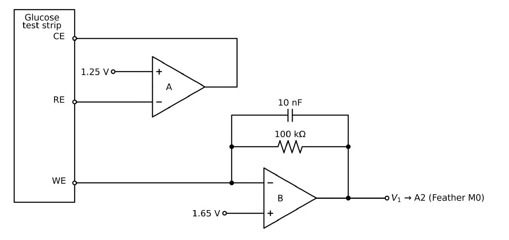
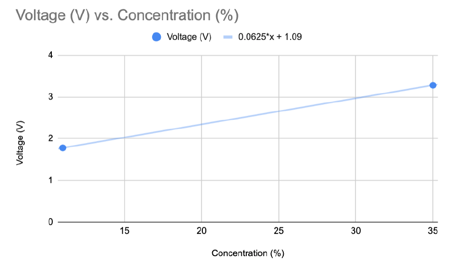

# Glucose Strip Reader

Measures glucose concentration from a disposable test strip. The strip's enzyme reaction produces a current. A two op-amp circuit turns that current into a voltage, and a Feather M0 reads it and converts it to concentration with a two-point calibration.

## How it works

1. The strip's working electrode reacts with glucose and releases electrons, which makes a current.
2. Op-amp A holds a fixed 0.4 V between the working and reference electrodes so the reaction runs consistently.
3. Op-amp B is a transimpedance amplifier (100 kOhm feedback with a 10 nF capacitor) that converts the current to voltage: `V1 = 1.65 V + current x 100 kOhm`.
4. The Feather M0 reads V1 on pin A2 (3.3 V reference, 10-bit ADC) and applies the inverted calibration `C = (V1 - 1.0925) / 0.0625`.
5. Voltage and concentration print over serial at 115200 baud, about every 10 ms.

## Calibration

Two solutions of known concentration were measured:

| Solution | Output voltage | Approx. current |
|---|---|---|
| 11% (control) | 1.78 V | 1.3 uA |
| 35% (high) | 3.28 V | 16.3 uA |

Linear fit: `V1 = 0.0625 * C + 1.0925` (V, % concentration).

## Hardware

- Feather M0
- Glucose test strip
- Two op-amps, 100 kOhm resistor, 10 nF capacitor, 1.25 V and 1.65 V references

## Run

Open `readStrip/readStrip.ino` in the Arduino IDE, upload, and open the serial monitor at 115200 baud.

## Limitations

- The calibration uses only two points, so a straight line is assumed and not checked.
- At 35% the output is 3.28 V, right at the ADC's 3.3 V ceiling. Higher concentrations would saturate the reading.
