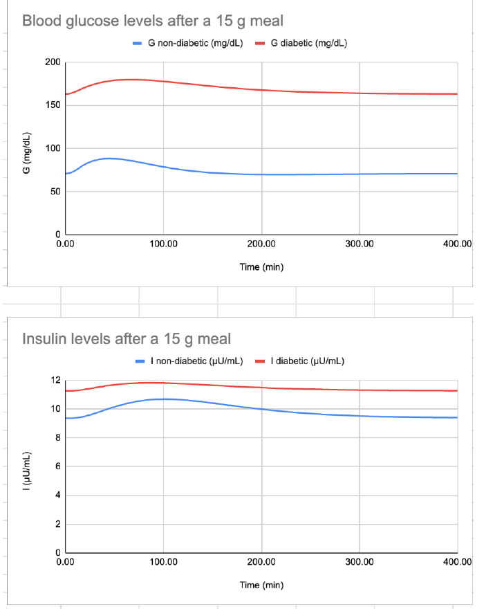
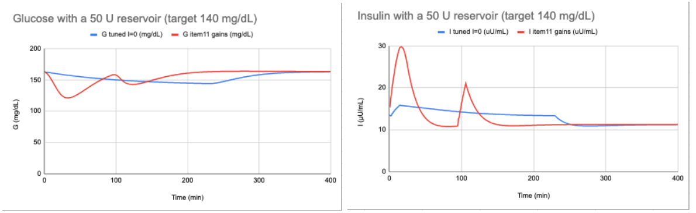

# Insulin Pump Simulation

Simulates blood glucose after a meal on an Arduino, then compares open-loop insulin delivery (boluses, basal) with a closed-loop PID pump controller. There is no real sensor or pump. Everything is computed in software.

## Model

Three differential equations are integrated with a simple Euler step. One loop pass is one simulated minute.

- **Q:** intestinal glucose
- **G:** blood glucose (mg/dL)
- **I:** insulin (uU/mL)

The meal is 15 g of glucose over 15 minutes, which is 300 mg/dL for a 5 L blood volume (15,000 mg / 50 dL). The code has parameter sets for a non-diabetic and a diabetic model.

| | Q(0) | G(0) | I(0) |
|---|---|---|---|
| Non-diabetic | 0 | 70.86 | 9.36 |
| Diabetic | 0 | 163 | 11.26 |

The diabetic model peaks higher and later (179.66 mg/dL at 66 min vs. 88.31 at 45 min) and takes longer to return near baseline (about 260 min vs. 170). Both rise by a similar amount (+16.7 vs. +17.5 mg/dL), so the higher peak comes mainly from the higher baseline. The diabetic model also has a smaller insulin response to the meal (+0.55 vs. +1.33 uU/mL), consistent with its lower insulin sensitivity (S = 0.00114 vs. 0.00306).

## Open-loop insulin (diabetic model)

| Strategy | Lowest glucose | Highest glucose after |
|---|---|---|
| 15 U bolus at meal start | ~145 mg/dL at 16 min | ~172 mg/dL at 115 min |
| 15 U bolus after the meal | ~150 mg/dL at 35 min | ~170 mg/dL at 131 min |
| 15 U before plus 15 U corrective after | ~129 mg/dL at 31 min | ~168 mg/dL at 149 min |
| 15 U before plus 0.5 U basal | ~114 mg/dL (near 400 min) | none, glucose keeps lowering and flattens |

A single bolus clears within about an hour, but the meal's glucose takes several hours to absorb, so every bolus-only case dips and then rebounds.

## Closed-loop PID control

The controller adds insulin in proportion to how far glucose is above target, with a derivative term on the rate of change. Tuned by trial and error, starting from P alone, then D, then I.

- **Target 163 mg/dL, P = 0.1, I = 0.1, D = 10:** glucose stayed within 162.7 to 163.3 mg/dL during the meal, using about 17.9 U. The meal spike dropped from +16.7 to +0.3 mg/dL (about 98%). D had the largest effect because it responds to the rising glucose before it gets high.
- **50 U reservoir, target 140 mg/dL:** with I = 0.1 the integral term kept growing while glucose stayed above target, so glucose overshot down to 121 mg/dL and the reservoir was empty by 107 min. Setting I = 0 (P = 0.1, D = 10) avoided the overshoot (lowest 144 mg/dL) and stretched the reservoir to about 230 min. After it empties, glucose drifts back to 163.

The sketch in this repo is the final reservoir run: target 140, Kp 0.1, Ki 0, Kd 10.

## Hardware

Feather M0. The simulation runs entirely in software, so no sensor or pump is attached.

## Run

Open `GlucoseSystem/GlucoseSystem.ino` in the Arduino IDE, upload, and read the output in the serial monitor or Serial Plotter. Each step prints step, Q, G, I and total insulin delivered, tab-separated, at 115200 baud. The run stops after 400 steps. The manual bolus scenarios are in the code comments. An SD logging function (`logToSD`) is included but not called by default.
